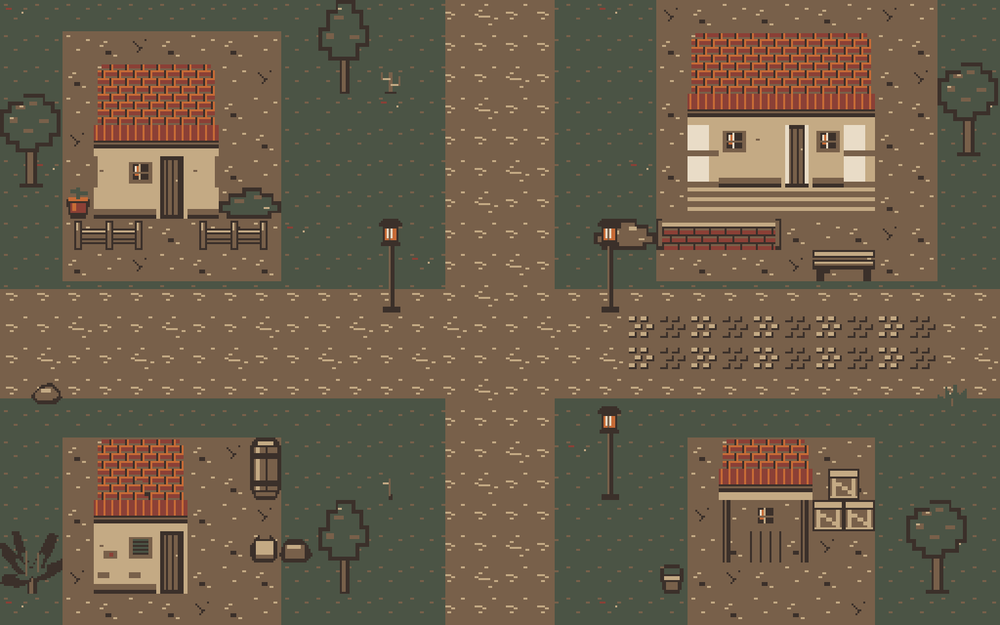

# Tileset lingkungan Bandung 1946

Paket pixel art sederhana orisinal untuk evaluasi dan perakitan map berikutnya. Mengikuti PRD bagian 7, 8 dan 11: top-down atas/depan, grid 16 x 16, tujuh warna palet proyek, tanpa antialias atau bayangan besar. Warna zaitun, tanah dan genteng kusam dipadukan sorotan lampu hangat untuk suasana sore menuju malam. Tidak ada perubahan scene, collider, mekanik atau TileSet gameplay.



## Isi paket

| Atlas | Ukuran PNG dengan padding | Grid | Aset logis | Sel 16 x 16 |
|---|---|---|---|---|
| assets/tilesets/terrain_16.png | 144 x 90 | 8 x 5 | 40 | 40 |
| assets/tilesets/buildings_16.png | 144 x 72 | 8 x 4 | 32 | 32 |
| assets/tilesets/environment_16.png | 144 x 108 | 8 x 6 | 25 | 48 |

Terrain mencakup tanah biasa/berbatu, jalan tanah/debu, batu biasa/aus, rumput, tanah kering, 16 sambungan jalan sempit, empat tepi jalan lebar, empat sudut luar, empat sudut dalam, serta empat dekorasi transparan. Permukaan penuh mengisi tile tanpa lubang alpha. Jangan menempatkan dekorasi transparan tanpa terrain dasar.

Bangunan menyediakan dinding plester/kayu/bata, bercak tua, genteng tengah/tepi/sudut/aus, lis atap, pintu kayu dan pintu tinggi dua tile, jendela, ventilasi, daun jendela, tiang, fondasi dan anak tangga. Empat blueprint di manifest memperlihatkan perakitan ulang modul:

| Blueprint | Ukuran rakitan |
|---|---|
| common_house | 64 x 80 |
| colonial_house | 96 x 96 |
| aged_building | 48 x 80 |
| guard_post | 48 x 64 |

Lingkungan mencakup dua pohon 32 x 48, dua semak 32 x 16, lima modul pagar kayu 16 x 16, empat modul tembok bata 16 x 16, lampu 16 x 48, peti 32 x 32, karung 32 x 16, pakis/batu/rumput/ember/pot/tanaman kering 16 x 16, tong 16 x 32, tanaman pisang 32 x 32 dan bangku 32 x 16. Siluet memakai alpha 0/255. Ukuran dan sel setiap objek dicatat di manifest.

## Koordinat dan padding

- [Indeks seluruh 120 sel](tile_index.md) mencatat ID, ukuran objek, koordinat atlas, pixel region serta offset pada objek.
- assets/tilesets/manifest.json adalah metadata mesin; assets/art_sources/tilesets.json adalah resep gambar dan blueprint yang dapat disunting.
- Koordinat atlas dimulai dari (0,0) di kiri atas. Konten tile (x,y) berada pada pixel region (1 + 18x, 1 + 18y, 16, 16).
- Setiap sel memiliki ekstrusi tepi 1 px di keempat sisi dan sudut. Stride 18 px menghasilkan margin luar 1 px dan separation antarkonten 2 px. Padding tidak ikut digambar di dunia.
- Objek besar dipecah menjadi sel 16 x 16. Susun setiap sel berdasarkan offset_px. Jangan memilih satu region besar melintasi gutter atlas karena akan memasukkan padding internal ke sprite.
- Mask jalan sempit memakai north=1, east=2, south=4, west=8. Jumlah bit menunjukkan tetangga terhubung; mask 0 adalah ujung terisolasi, mask 15 persimpangan penuh. Road edge/corner/inner dipakai untuk jalan lebih lebar. Peering terrain Godot belum dikonfigurasi.

## Menggunakan di Godot

1. Import tiga PNG. Gunakan kompresi Lossless, mipmap nonaktif dan Texture Filter Nearest; project saat ini sudah nearest.
2. Pada TileSet baru atau source baru di resource milik tim, pilih Tile Size 16 x 16 dan buat Atlas Source. Texture Region Size = (16,16), Margins = (1,1), Separation = (2,2).
3. Buat tile untuk koordinat sel pada indeks. Susun modul sesuai blueprint dan objek besar sesuai offset; skala dunia tetap 1:1. Paket ini tidak menyimpan resource .tres atau mengganti map lama.
4. Gunakan layer terrain dasar dan dekorasi terpisah jika diperlukan. Collision, pengurutan terhadap karakter, navigasi serta terrain peering disiapkan saat integrasi map nanti. Tentukan collider batang/dinding secara manual, bukan dari seluruh siluet transparan.

Pengujian CLI membuat TileSetAtlasSource sementara di memori untuk ketiga tekstur dan memeriksa seluruh region; tidak ada resource TileSet yang ditulis ke disk.

## Regenerasi

Dari akar repo di PowerShell:

```powershell
$GodotExe = 'C:\Users\IDEAPAD SLIM 3\Downloads\Godot_v4.7.2-stable_win64.exe\Godot_v4.7.2-stable_win64_console.exe'
& $GodotExe --headless --path . --script tools/generate_tilesets.gd
& $GodotExe --headless --path . --editor --import --quit
& $GodotExe --headless --path . --script tools/generate_tilesets.gd -- --check
& $GodotExe --headless --path . --script tests/tileset_assets_test.gd
```

Periksa $LASTEXITCODE dan pesan ERROR/FAIL pada setiap perintah. Generator menggunakan Image bawaan Godot dan helper pipeline yang sudah ada; tidak ada dependensi baru. Edit resep JSON atau fungsi material dalam tools/generate_tilesets.gd, bukan PNG keluaran. Penempatan contoh map ada di assets/art_sources/tileset_preview.json. Mode --check membandingkan seluruh piksel dan teks metadata tanpa menulis file.

Generator memiliki enam PNG: tiga atlas, contact_sheet.png 832 x 1536, map_preview.png 512 x 320 (32 x 20 tile), dan map_preview_3x.png 1536 x 960. Dua metadata keluaran adalah manifest dan indeks tile. Contact sheet menampilkan semua sel, koordinat dan latar kotak untuk menunjukkan transparansi; label tidak terdapat di atlas dunia. docs/.gdignore mengecualikan preview dari impor gameplay.

## Evaluasi dan batas

[Contact sheet](contact_sheet.png) dan map diperiksa secara visual pada pembesaran nearest. [Laporan QA](qa_report.md) menjelaskan tes yang benar-benar dijalankan. Aset ini pixel art sederhana untuk MVP, belum ilustrasi lingkungan final. Repetisi tekstur dan pohon masih terlihat; detail material dapat diperkaya setelah dicoba bersama karakter pada map sebenarnya.

Rumah dan properti adalah interpretasi artistik generik, bukan rekonstruksi bangunan Bandung tertentu yang diverifikasi. Peninjauan Rama/Fahkri terhadap referensi berizin tetap diperlukan sebelum presentasi sejarah final. Tidak ada sprite komersial, lambang militer atau aset LORONG 1943 yang disalin.
